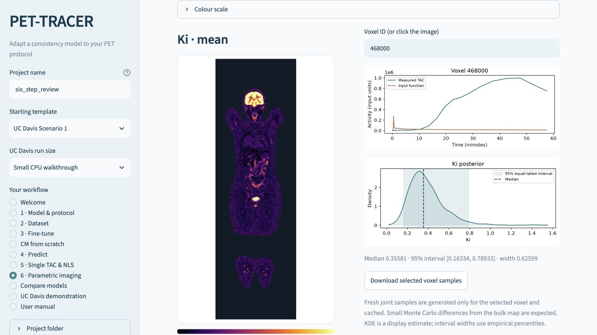

# Parametric imaging and interactive voxel inspection

[User manual](../README.md) · [UC Davis steps 1–6](UCDAVIS.md) · [Prediction](PREDICTION.md)

**6 · Parametric imaging** converts voxel predictions into an image. The default is **Kᵢ posterior mean** for the supplied UC Davis Sub001 coronal slice. The released example is one slice through the body; it is not a complete 3D patient volume.



*Interface preview using the small installation-check model.*

## Choose the imaging model

Select **Model for parametric imaging**: LoRACM or a trained scratch CM. A map belongs to the selected model's own prediction file. **Generate a map prediction with the selected model** creates it from step 6 with checkpoint, sample count, sampling steps and memory controls. Existing outputs are preserved with new numbered filenames. The voxel inspector checks the input and checkpoint checksums against the map.

## GUI workflow

1. In step 4, predict **UC Davis patient slice** using the model trained in steps 1–3. Include all 24,237 foreground voxels. Simulated test pairs can assess accuracy but have no anatomical coordinates.
2. Open **6 · Parametric imaging**. The prediction output and model folder follow your preceding run. The supplied geometry is selected automatically.
3. Choose Kᵢ or any predicted kinetic parameter. Choose **Posterior mean**, **Posterior median**, or **95% credible-interval width**.
4. Click a foreground voxel in the image on the **left**. On the **right**, the app displays that voxel's measured TAC and input function in one graph, followed by a KDE of the chosen parameter's posterior. Entering a voxel ID also supports keyboard access.
5. Export the map figure, numeric map or selected voxel's joint posterior samples.

The app generates and caches joint samples only for the selected voxel, using the model/checkpoint and measured data that generated the image. It verifies voxel identities, schedule and file checksums. These fresh Monte Carlo draws can differ slightly from the bulk map summaries. A KDE is a smoothed display of samples; interval limits are empirical percentiles.

UC Davis initially uses **Paper display**: the original 2×2 median filter, with a fixed 0–0.06 scale for Ki mean/median. Select **Raw values** to disable filtering. Other maps use 2nd/98th percentile limits. Numeric exports preserve the raw `image` and separately include `display_image`; the displayed plane is not a new voxel posterior. A tiny two-epoch walkthrough model and eight draws per voxel demonstrate the interface; they do not establish posterior calibration or useful research estimates.

## What uncertainty means here

For each voxel and parameter, the equal-tailed 95% credible interval is:

```text
lower = percentile(posterior draws, 2.5)
upper = percentile(posterior draws, 97.5)
width = upper - lower
```

Width is in the parameter's units. It is **not** its posterior standard deviation or the uncertainty of its posterior mean. Wider intervals describe more spread in the model's samples; assess calibration separately.

For built-in 2TC, Kᵢ is calculated for every joint draw as `K1*k3/(k2+k3)`, then its percentiles are calculated. The code does not substitute mean parameters into that equation. Draws with `abs(k2+k3) <= 1e-12` are excluded and `Ki_valid_fraction` reports the retained fraction. The UC Davis paper recipe explicitly floors K1, k2 and k3 to 1e-4 before the joint-draw Ki transformation, matching the HPC selected-voxel code. Custom projects use raw draws. The selected policy is recorded in prediction metadata; parameter draws themselves are unchanged. Custom models expose their predicted parameters; this 2TC-specific Kᵢ transform is not imposed on them.

New prediction files contain `params_ci95_low`, `params_ci95_high`, `params_ci95_width`, and corresponding `Ki_*` arrays where applicable. Older files can display available mean/median maps, but need updated inference to obtain interval-width maps. Keeping all whole-image draws is unnecessary: exact percentiles are calculated within each inference batch.

## Geometry for your own project

### Your own patient scan and mask

Reuse a trained model on a new patient through **4 · Predict** (LoRACM) or **CM · Predict** (scratch CM):

1. Choose **My own patient scan**, then load its coronal TAC/AIF slice as prediction NPZ or pandas HDF5. The trained frame schedule and durations must match.
2. Load the **corresponding mask** as a binary `.npy`, or an `.npz` containing `mask`. A 2D mask directly describes the slice. For a 3D mask, choose its array axis and slice index. The mask must have exactly one foreground pixel per TAC.
3. Confirm the TAC columns follow foreground pixels in NumPy C order, or load an explicit CSV with `voxel_columns,voxel_indices`. Indices refer to the selected 2D mask flattened in C order.
4. Set image origin and pixel aspect ratio, and confirm you verified the mapping and display convention against your data export.
5. Validate and predict. The app prepares `patient_scans/<identity>/geometry.npz` and `geometry.json`, then carries that patient's input, mask/mapping and prediction into step 6.
6. Choose **Ki** (built-in 2TC), any fitted parameter, or a **95% credible-interval width**. Click a foreground voxel to see that patient's TAC/AIF and posterior KDE.

The original patient slice and mask stay unchanged. Geometry records input/mask checksums; a map is rejected if its input differs, even when both patients use identical voxel IDs. The supplied UC Davis mask is bound to the supplied Sub001 file and is not reused for other patients. Generic TAC files without anatomical masks remain valid for batch/single-TAC prediction through **My own file**.

For a terminal workflow, first verify the ordering and display convention, then prepare the mask:

```bash
python prepare_scan.py --input new_patient_slice.h5 --mask corresponding_mask.npy --output workspaces/my_project/patient_scans/patient02 --verified --origin lower --aspect 1
python infer.py --run workspaces/my_project/runs/adaptation --input new_patient_slice.h5 --output workspaces/my_project/patient02_predictions.npz --samples 1000
python parametric_imaging.py --predictions workspaces/my_project/patient02_predictions.npz --geometry workspaces/my_project/patient_scans/patient02/geometry.npz --geometry-metadata workspaces/my_project/patient_scans/patient02/geometry.json --parameter Ki --statistic mean --output workspaces/my_project/patient02_Ki.png
```

Change `--parameter Ki` to a fitted parameter name and/or `--statistic ci95_width`. Custom models can set `prepare_scan.py --parameter-dim P`. For a 3D source mask add `--axis` and `--slice`; an explicit voxel mapping uses `--mapping-csv`. This workflow accepts already exported TACs and NumPy masks, not raw scanner DICOM/NIfTI images.

### Prepared geometry format

Supply a geometry NPZ with:

| Array | Required content |
| :--- | :--- |
| `mask` | Binary 2D slice or 3D volume |
| `voxel_indices` | One unique C-order flat foreground index per TAC |
| `voxel_columns` | Matching unique string identifiers, also used in the prediction/input file |

Supply a JSON sidecar with `mapping_verified: true`, `orientation_and_spacing_verified: true`, `origin: "lower"` or `"upper"`, and a positive `pixel_aspect_ratio`. Optional `shape` must match the mask. Verify these facts against the original image/data export before setting the flags. For 3D arrays, select the display axis and slice index; axes are array axes unless you supply an external anatomical interpretation.

Complete imaging requires all foreground voxel identities. Unknown, duplicate, missing or background indices are rejected. Predictions are joined to geometry by **voxel ID**, so their row order can differ without changing spatial correspondence. The UC Davis author confirmed the supplied C-order mapping and original notebook display convention; its geometry JSON records that confirmation. The display uses pixel coordinates because physical millimetre spacing is not supplied.

## Terminal equivalents

Run from `PET-TRACER/LoRACM`. For the small walkthrough:

```bash
python parametric_imaging.py --predictions workspaces/ucdavis_walkthrough/runs/scenario1_small/predictions.npz --parameter Ki --statistic mean --output workspaces/ucdavis_walkthrough/Ki_mean.png
python parametric_imaging.py --predictions workspaces/ucdavis_walkthrough/runs/scenario1_small/predictions.npz --parameter Ki --statistic ci95_width --output workspaces/ucdavis_walkthrough/Ki_ci95_width.png
python parametric_imaging.py --predictions workspaces/ucdavis_walkthrough/runs/scenario1_small/predictions.npz --parameter K1 --statistic ci95_width --output workspaces/ucdavis_walkthrough/K1_ci95_width.png
```

Each command exports a PNG, a numeric map NPZ and a provenance JSON. Pass `--geometry` and `--geometry-metadata` for your own data, and `--axis` / `--slice` for a 3D array. Existing outputs are protected.

Inspect one voxel and save its TAC/AIF and joint samples:

```bash
python inspect_voxel.py --run workspaces/ucdavis_walkthrough/runs/scenario1_small --input data/real/Sub001_slice75_adjusted.h5 --voxel-id 33449 --output workspaces/ucdavis_walkthrough/voxel_33449.npz --samples 1000 --device cpu
python plot_posteriors.py --posterior workspaces/ucdavis_walkthrough/voxel_33449.npz --output workspaces/ucdavis_walkthrough/voxel_33449_posteriors.png
```

The extraction file `voxel_33449.input.npz` can also be used with the [single-TAC NLS commands](PREDICTION.md#terminal-single-tac-analysis).
