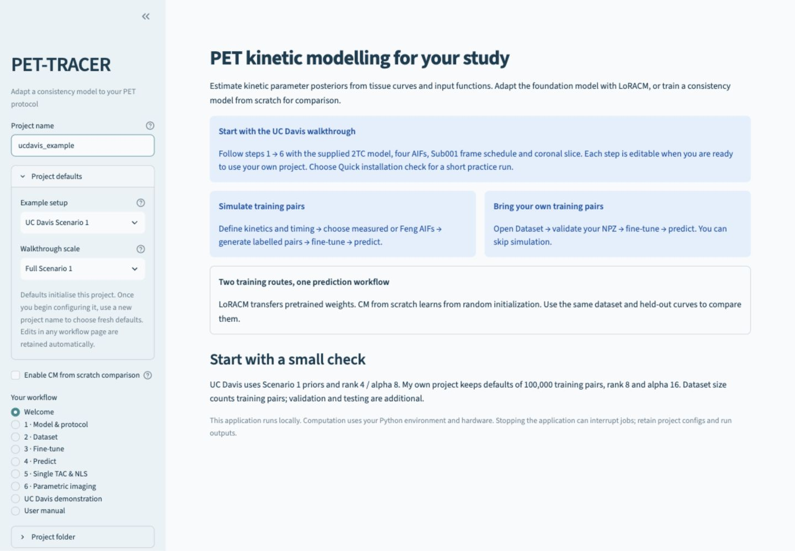
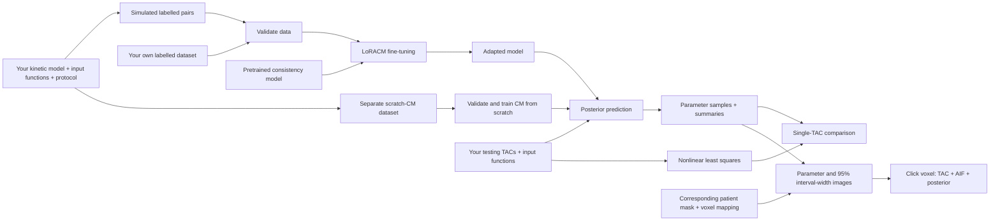

# PET-TRACER

**Bayesian kinetic modelling for dynamic total-body PET**

Latest Release: Adapt a pretrained consistency model to your tracer, time sampling schedule, and acquisition protocol.

[User manual](LoRACM/README.md) · [GUI guide](LoRACM/docs/WORKBENCH.md) · [Installation](LoRACM/docs/INSTALLATION.md) · [UC Davis example steps 1–6](LoRACM/docs/UCDAVIS.md) · [Parametric imaging](LoRACM/docs/PARAMETRIC_IMAGING.md) · [Original framework](docs/legacy-framework.md)

PET-TRACER (**PET** **T**otal-body Paramet**R**ic **A**nalysis via **C**onsistency **E**stimation for **R**adiotracers) estimates kinetic parameter posteriors from tissue time–activity curves (TACs) and input functions. **LoRACM** adds low-rank adaptation: fine-tune the pretrained consistency model with labelled examples from your application, then predict on your own curves. A separate **CM from scratch** module trains a random-initialization baseline for comparison on shared held-out data.

Team: **Yun Zhao and Steven Meikle** (The University of Sydney, Australia), **Andrew Reader** (King’s College London, UK), and **Yanan Fan** (CSIRO’s Data61, Australia). The [original framework page](docs/legacy-framework.md) contains the method introduction, figures, team information, and first-paper demonstrations.

## Two ways to work

| Local graphical interface | Terminal workflow |
| :--- | :--- |
| Guided pages for protocol setup, data validation, training, and prediction. Runs locally in your browser. | The same workflow through Python commands and editable configuration files. Suitable for servers and batch jobs. |
| [Launch the GUI](LoRACM/docs/INSTALLATION.md#next-repo-version-launch-without-reinstalling) | [Terminal quick start](LoRACM/README.md#terminal-quick-start) |

The new workflow is designed for **Windows, Apple Silicon macOS (M-series), and Linux** with Python 3.11. CPU is the common baseline; PyTorch can use a supported CUDA GPU or Apple MPS device. Standard installation includes CPU JAX for dataset generation. See the [platform and acceleration guide](LoRACM/docs/INSTALLATION.md#hardware-and-platform-support). Windows users: double-click **Setup PET-TRACER.cmd**, choose NVIDIA GPU or CPU, then open **Launch PET-TRACER.cmd** when setup completes. [Windows guide](LoRACM/docs/WINDOWS.md).



## Start here

1. **[Install once outside the repo](LoRACM/docs/INSTALLATION.md)**: Windows users double-click **Setup PET-TRACER.cmd**; macOS/Linux users run `setup_environment.py`. Then launch the GUI or open a terminal. New downloads reuse the same environment.
2. **[Reproduce the UC Davis paper example](LoRACM/docs/UCDAVIS.md)** using the supplied epoch-2755 checkpoint, or follow steps 1–6 to simulate and retrain. Choose **Quick installation check** only to check installation.
3. Choose your data route:
   - **[Simulate labelled pairs](LoRACM/docs/MODELS_AND_PROTOCOLS.md)** using 2TC or your own kinetic model, measured AIFs or a fitted Feng cohort, and your frame schedule.
   - **[Prepare your own dataset](LoRACM/docs/PREPARE_DATA.md)** and validate its format before training.
4. **[Fine-tune](LoRACM/docs/FINE_TUNING.md)** with defaults of **100,000 training pairs, LoRA rank 8, alpha 16**; track losses and learning rate. The optional **[CM from scratch](LoRACM/docs/TRAIN_CM.md)** route has separate dataset, training and prediction pages.
5. **[Predict on your own project](LoRACM/docs/PREDICTION.md)** in batches, or analyse one TAC with parameter posterior histograms, an NLS comparison and forward TACs from posterior medians.
6. **[Make parametric images](LoRACM/docs/PARAMETRIC_IMAGING.md)** of Kᵢ, fitted parameters or 95% credible-interval widths. Use the UC Davis example or your own patient's coronal TAC/AIF slice and corresponding mask. Click a voxel to view its TAC, input function and posterior KDE.

## Reproduce the UC Davis example (Scenario 1 in our paper)

In the GUI, choose **UC Davis demonstration → Reproduce paper Ki map**. The original model, patient slice and verified geometry are included. Or, after installation, run:

```bash
cd LoRACM
python reproduce_ucdavis.py --workspace workspaces/ucdavis_paper --device auto
```

This uses the original epoch-2755 weights, 1,000 joint draws and three reverse steps. Fresh sampling has Monte Carlo variation. Retraining with the supplied settings is a separate experiment and need not yield identical weights across devices. [Settings, six-step training guide and provenance](LoRACM/docs/UCDAVIS.md).



## What you can do

| Feature | Guide |
| :--- | :--- |
| Choose 2TC or define a custom single-input ODE with a different parameter set | [Kinetic models and transfer limits](LoRACM/docs/MODELS_AND_PROTOCOLS.md#kinetic-models) |
| Use measured AIFs, fit a cohort with Feng, and simulate new inputs | [Input functions](LoRACM/docs/MODELS_AND_PROTOCOLS.md#input-functions) |
| Set isotope half-life/decay, frame midpoints, durations, noise, and observation convention | [Acquisition protocol](LoRACM/docs/MODELS_AND_PROTOCOLS.md#acquisition-protocol) |
| Check your labelled training/validation/test file | [Dataset preparation](LoRACM/docs/PREPARE_DATA.md) |
| Select dataset size, LoRA rank/alpha, and training settings | [Fine-tuning](LoRACM/docs/FINE_TUNING.md) |
| Train a new CM without foundation weights and compare it with LoRACM | [Scratch training and paired evaluation](LoRACM/docs/TRAIN_CM.md) |
| Configure epochs, learning rate, embedding width, architecture and automatic data dimensions | [Shared training settings](LoRACM/docs/TRAIN_CM.md#defaults-and-settings) |
| Follow losses and export an adapted model | [Training progress and outputs](LoRACM/docs/FINE_TUNING.md#progress-and-outputs) |
| Predict batches or inspect one TAC, its posterior samples, and dashed NLS estimates | [Prediction manual](LoRACM/docs/PREDICTION.md) |
| Display Kᵢ or any predicted parameter, with 95% credible-interval-width maps and clickable voxel inspection | [Parametric imaging](LoRACM/docs/PARAMETRIC_IMAGING.md) |
| Reproduce the original first-paper examples | [Legacy page](docs/legacy-framework.md) · [Single TAC](Single_TAC_Demo.ipynb) · [Total-body imaging](Total_Body_Parametric_Imaging_Demo.ipynb) |

## Original framework and LoRACM

The first-paper framework remains accessible at **[docs/legacy-framework.md](docs/legacy-framework.md)**. Original source, notebooks, sample data, and pretrained assets retain their paths, so a paper link to this repository still leads to the original material. Existing published GitHub release archives are unchanged by this update.

LoRACM's included research example adapts **FDG–2TCM from the Siemens Biograph Vision Quadra protocol to the UC Davis uEXPLORER protocol**. Its preserved settings (rank 4, alpha 8) are distinct from new-project defaults. Custom models are supported through a documented plugin contract; transferring compatible weights to a new model or tracer still requires application-specific validation.

## Repository map

```text
PET-TRACER/
├── README.md                       Project overview and manual index
├── launch_gui.py                   Cross-platform local GUI launcher
├── setup_environment.py            Reusable environment outside the checkout
├── Setup PET-TRACER.cmd            Windows environment installer
├── setup_windows.ps1               Python bootstrap and device verification
├── Launch PET-TRACER.command        macOS launcher
├── Launch PET-TRACER.cmd            Windows launcher
├── launch_gui.sh                    Linux/macOS launcher
├── docs/legacy-framework.md        Original framework page
├── Source/, Pretrained/, Sample_data/, Assets/
├── Single_TAC_Demo.ipynb, Total_Body_Parametric_Imaging_Demo.ipynb
└── LoRACM/
    ├── README.md                   Step-by-step user manual
    ├── gui/                        Guided local interface
    ├── configs/, examples/         Editable configs, schedule and custom model
    ├── protocol.py                 Dataset/protocol validation
    ├── fit_feng.py, simulate_protocol.py
    ├── train.py, train_cm.py        LoRACM adaptation and scratch CM training
    ├── infer.py, compare_models.py  Shared prediction and paired comparison
    ├── analyse_tac.py, plot_posteriors.py
    ├── ucdavis.py                   Default numbered demonstration settings
    ├── reproduce_ucdavis.py         Original paper model → Ki image
    ├── paper/ucdavis/               Paper checkpoint, scaling and reference map
    ├── parametric_imaging.py, inspect_voxel.py
    ├── create_dataset.py            Preserved UC Davis research generator
    ├── data/, checkpoints/, notebooks/
    ├── docs/, tests/
    └── workspaces/                 Your projects and outputs (Git-ignored)
```

## Research, support, and licence

- **Original paper:** *Generative Consistency Models for Estimation of Kinetic Parametric Image Posteriors in Total-Body PET*. [IEEE Transactions on Medical Imaging](https://ieeexplore.ieee.org/abstract/document/11517565).
- **LoRACM:** *A General-Purpose Adaptable Foundation Model for Total-Body PET Kinetic Modelling*. The repository describes the manuscript as in preparation; public citation metadata will be added when available.

Please cite the original framework and the adaptation paper when its public reference is available. For help, [open an issue](https://github.com/yundumbledore/PET-TRACER/issues) or contact **yun.zhao@sydney.edu.au** / **steven.meikle@sydney.edu.au**.

Software: [MIT licence](LICENSE). Assets: [data and model provenance](LoRACM/docs/DATA_PROVENANCE.md). Checks performed and their limits: [validation report](LoRACM/docs/VALIDATION.md). Historical file inventory: [release manifest](MANIFEST.json), whose original hashes describe the earlier archive rather than this working-tree update.
